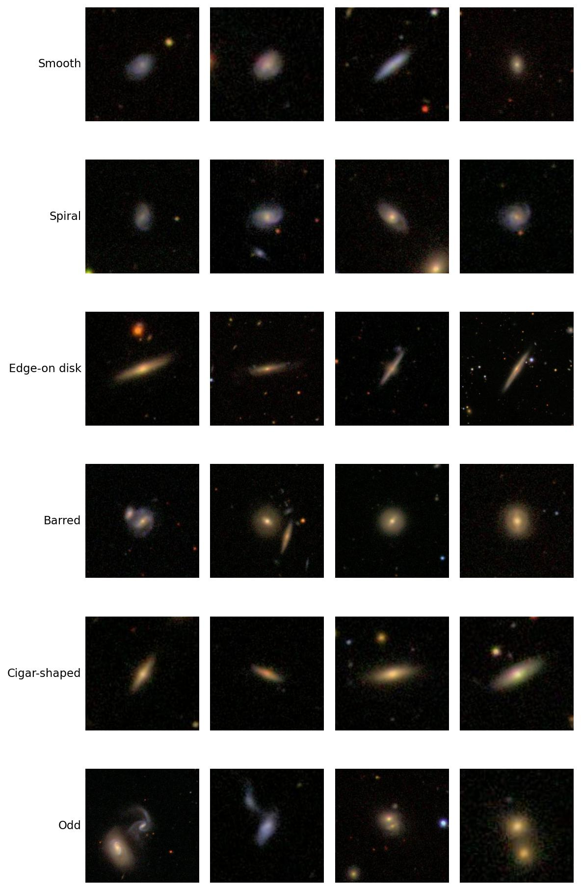
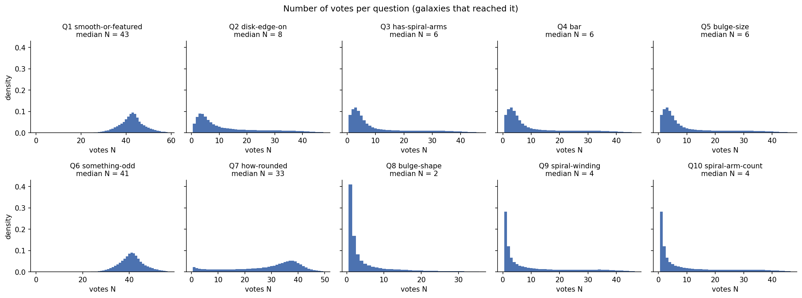
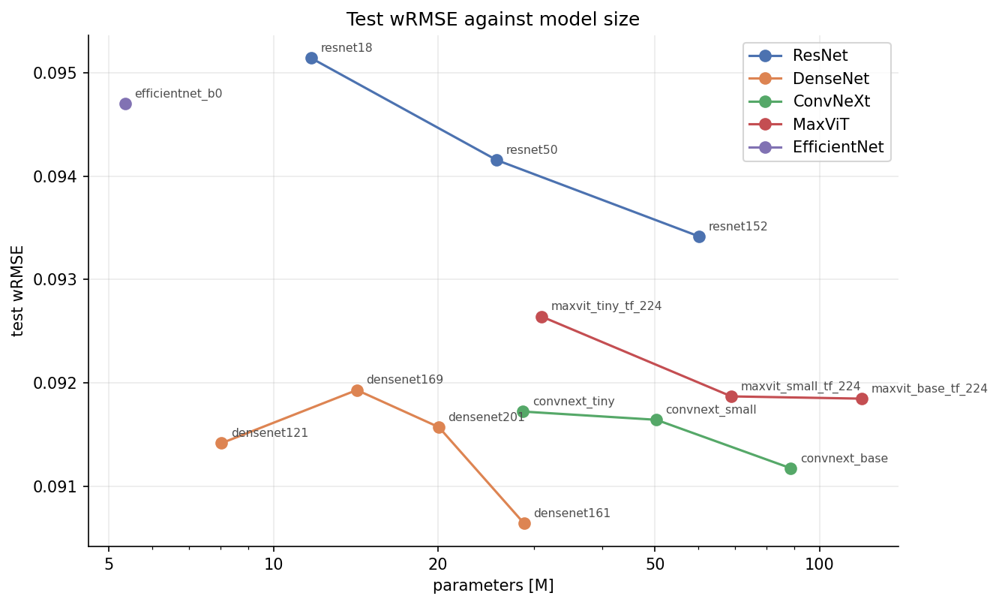
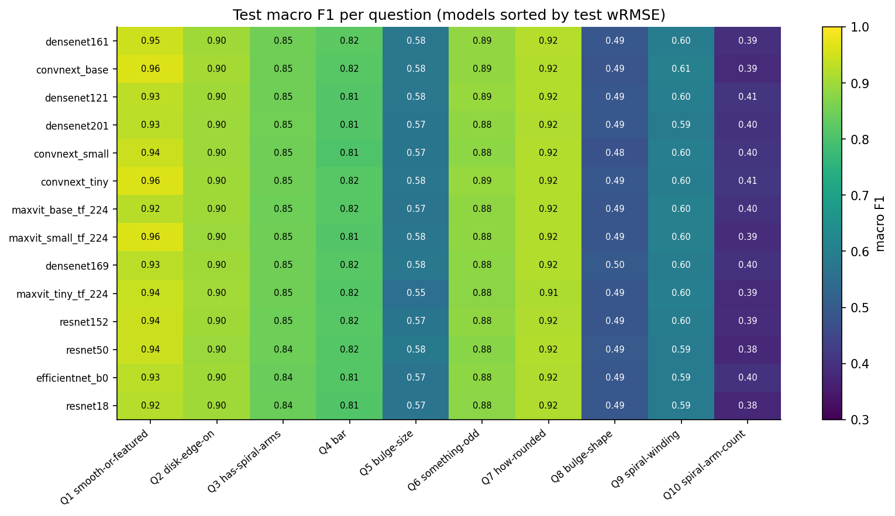
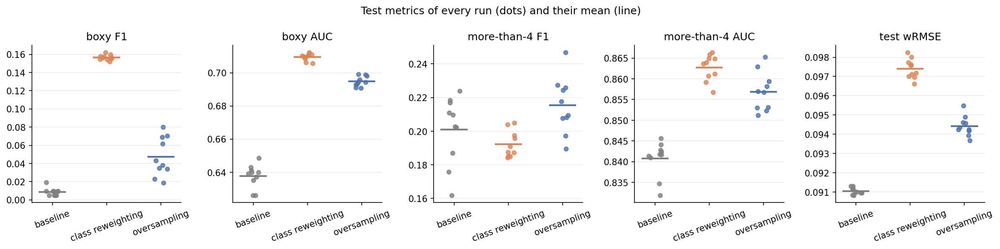

# Galaxy morphology classification based on astronomical images from Galaxy Zoo 2 project

## Problem

In [Galaxy Zoo 2](https://data.galaxyzoo.org/) project volunteers classified SDSS galaxy images by
answering a decision tree of 10 questions (smooth or featured? edge-on disk? bar? how many
spiral arms? ...). Every galaxy has between a few and a few dozen votes per question. The
label is not a single class but the **vote fractions for all 30 answers**, and the task is to
predict them from the image.

### Samples from dataset



Two properties of these labels shape everything else:

- **Vote depth collapses down the tree.** The first question gets a median of 43 votes per
  galaxy, the bulge-shape question (Q8) only 2, and 41% of Q8 labels come from a single vote.
- **The deep questions are heavily imbalanced.** `boxy` bulges are 5% of the galaxies that
  reach Q8, and galaxies with 3, 4 or more than 4 spiral arms are 1-3% of those reaching Q10.



## Approach

- **Dirichlet-Multinomial loss.** The network outputs Dirichlet concentrations α > 0 for
  each question, and the loss is the likelihood of the observed vote counts. Galaxies with
  many votes count more than galaxies with one, and questions a galaxy never reached
  contribute nothing. Predicted fractions are α normalised within each question
  (Walmsley et al. 2022).
- **One training setup for every model.** ImageNet-pretrained backbone from `timm` with an
  MLP head, AdamW with lower learning rates for the backbone, random rotation, flips and
  colour jitter, mixed precision, `ReduceLROnPlateau` and early stopping.
- **Metrics.** Vote-weighted RMSE of the predicted fractions (wRMSE), and macro F1 per
  question with the majority vote as the class label.

## Results

### Fourteen architectures

| Model           | Parameters | Test wRMSE |   Mean F1 |
| --------------- | ---------: | ---------: | --------: |
| DenseNet-161    |      28.8M | **0.0906** |     0.739 |
| ConvNeXt-Base   |      88.6M |     0.0912 |     0.739 |
| DenseNet-121    |       8.0M |     0.0914 |     0.737 |
| DenseNet-201    |      20.1M |     0.0916 |     0.735 |
| ConvNeXt-Small  |      50.3M |     0.0916 |     0.735 |
| ConvNeXt-Tiny   |      28.6M |     0.0917 | **0.741** |
| MaxViT-Base     |     119.5M |     0.0918 |     0.736 |
| MaxViT-Small    |      69.0M |     0.0919 |     0.738 |
| DenseNet-169    |      14.2M |     0.0919 |     0.737 |
| MaxViT-Tiny     |      31.0M |     0.0926 |     0.733 |
| ResNet-152      |      60.3M |     0.0934 |     0.735 |
| ResNet-50       |      25.6M |     0.0942 |     0.734 |
| EfficientNet-B0 |       5.4M |     0.0947 |     0.733 |
| ResNet-18       |      11.7M |     0.0951 |     0.730 |

All 14 models are within 0.005 test wRMSE of each other. Within a family, ten times more
parameters improves wRMSE by at most 0.002.



The models are also weak on the same questions: every one scores above 0.87 macro F1 on
Q1, Q2, Q6 and Q7, and below 0.61 on bulge size, bulge shape, spiral winding and the number
of spiral arms. About 90% of the validation loss lies below a lower bound set by the labels
themselves, so the ceiling comes from the votes, not from the architectures.



### Class reweighting and oversampling

Can the rare answers be recovered? DenseNet-121 was trained ten times each (ten seeds)
without intervention, with class-reweighted loss, and with oversampling of rare answers to
Q8-Q10.

|                   |            Baseline | Class reweighting |    Oversampling |
| ----------------- | ------------------: | ----------------: | --------------: |
| Test wRMSE        | **0.0911** ± 0.0002 |   0.0974 ± 0.0005 | 0.0944 ± 0.0005 |
| `boxy` F1         |       0.009 ± 0.004 | **0.157** ± 0.003 |   0.047 ± 0.021 |
| `boxy` AUC        |       0.638 ± 0.007 | **0.710** ± 0.002 |   0.695 ± 0.003 |
| `more-than-4` F1  |       0.201 ± 0.020 |     0.192 ± 0.008 |   0.215 ± 0.017 |
| `more-than-4` AUC |       0.841 ± 0.004 | **0.863** ± 0.003 |   0.857 ± 0.005 |

Both interventions improve how well the model ranks galaxies with rare answers (AUC), and
reweighting raises the recall of `boxy` bulges from 0.4% to 52%. F1 for `more-than-4` spiral
arms, a label usually based on about four votes, does not change beyond the seed-to-seed
spread. Both interventions make the predicted vote fractions worse, so for the main task the
baseline remains the best choice.



## Repository structure

```
src/
  config.py       paths, seed, batch size, device
  data.py         GZ2 label schema: questions, answers, column names, slices
  dataset.py      PyTorch dataset and train/val/test splits
  transforms.py   training and evaluation augmentation
  loss.py         Dirichlet-Multinomial loss, α → vote fractions
  metrics.py      masked RMSE, vote-weighted RMSE
  train.py        model, optimizer, training loop with early stopping
  evaluate.py     predictions and per-question classification metrics
  sampling.py     class weights and oversampling weights
  eda.py          helpers for the exploratory notebook
scripts/
  train.py                  train one model
  evaluate.py               evaluate checkpoints → results/runs/<run>.json
  run_benchmark.sh          the 14-architecture benchmark
  run_class_imbalance.sh    the 30 class-imbalance runs
notebooks/
  01_eda.ipynb              the labels: vote depth, imbalance, splits, augmentation
  02_benchmark.ipynb        architecture comparison and error analysis
  03_class_imbalance.ipynb  class reweighting and oversampling
results/runs/               evaluation results of every trained model
figures/                    figures used in this README
```

## Usage

Requires Python 3.11+ and a CUDA GPU for training.

```bash
python -m venv .venv
source .venv/bin/activate
pip install -e ".[dev]"
```

The dataset ([`mwalmsley/gz2`](https://huggingface.co/datasets/mwalmsley/gz2), 172k training
and 18k test galaxies) is downloaded from HuggingFace on first use and cached in `data/`.

```bash
# train one model
python -m scripts.train --arch densenet121.tv_in1k

# evaluate checkpoints on the validation and test sets
python -m scripts.evaluate models/gz2_*_best.pth

# reproduce all experiments
bash scripts/run_benchmark.sh
bash scripts/run_class_imbalance.sh
```

The notebooks need no GPU or trained models: `02_benchmark` and the results part of
`03_class_imbalance` read only `results/runs/`, and the rest uses the dataset.

## Data and acknowledgements

The labels come from Galaxy Zoo 2 (Willett et al. 2013), in the version prepared by Mike
Walmsley and published on HuggingFace as
[`mwalmsley/gz2`](https://huggingface.co/datasets/mwalmsley/gz2) under
[CC BY-NC-SA 4.0](https://creativecommons.org/licenses/by-nc-sa/4.0/). The dataset is not
included in this repository.

This work would not be possible without the Galaxy Zoo volunteers, whose classifications
are the labels used here. The galaxy images are from the
[Sloan Digital Sky Survey](https://www.sdss.org/).

## References

- Willett et al. (2013), _Galaxy Zoo 2: detailed morphological classifications for 304 122
  galaxies from the Sloan Digital Sky Survey_, MNRAS 435, 2835
- Dieleman, Willett & Dambre (2015), _Rotation-invariant convolutional neural networks for
  galaxy morphology prediction_, MNRAS 450, 1441
- Walmsley et al. (2022), _Galaxy Zoo DECaLS: detailed visual morphology measurements from
  volunteers and deep learning for 314 000 galaxies_, MNRAS 509, 3966
- Walmsley et al. (2023), _Zoobot: adaptable deep learning models for galaxy morphology_,
  JOSS 8, 5312

## License

The code is released under the [MIT License](LICENSE).

The figures in `figures/` and the results in `results/` are derived from the Galaxy Zoo 2
dataset and are shared under [CC BY-NC-SA 4.0](https://creativecommons.org/licenses/by-nc-sa/4.0/),
the license of the dataset. The same applies to any model weights trained with this code
on that data.
